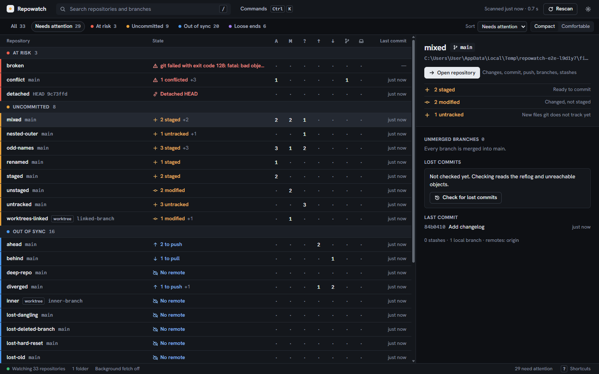
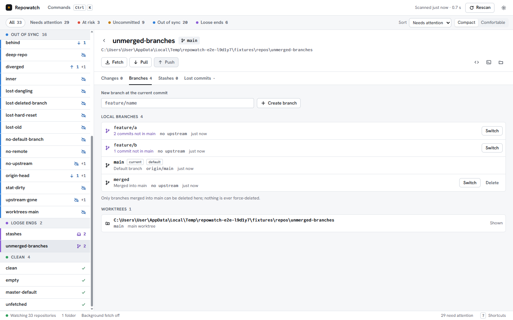
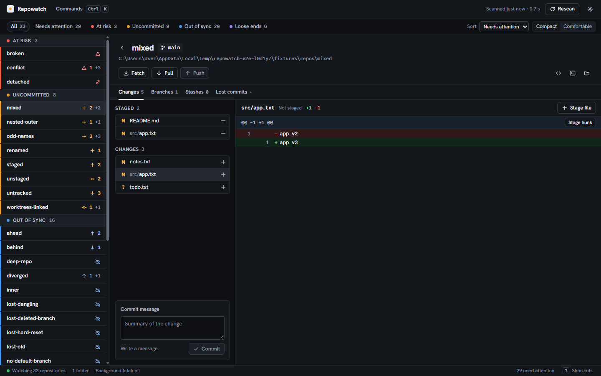
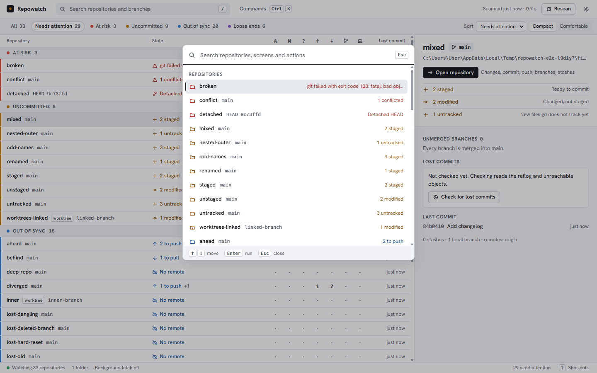
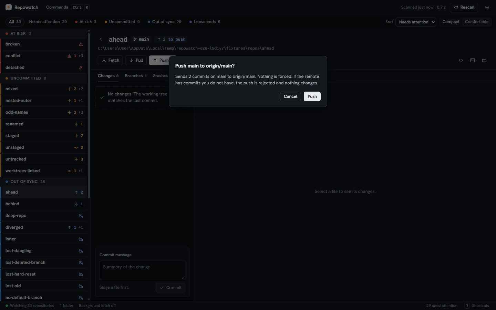
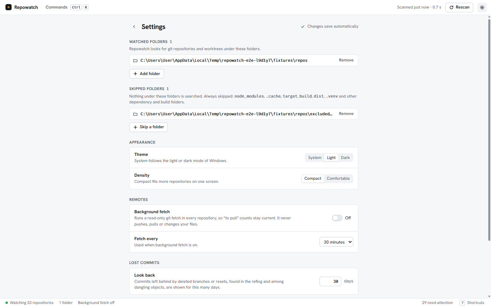
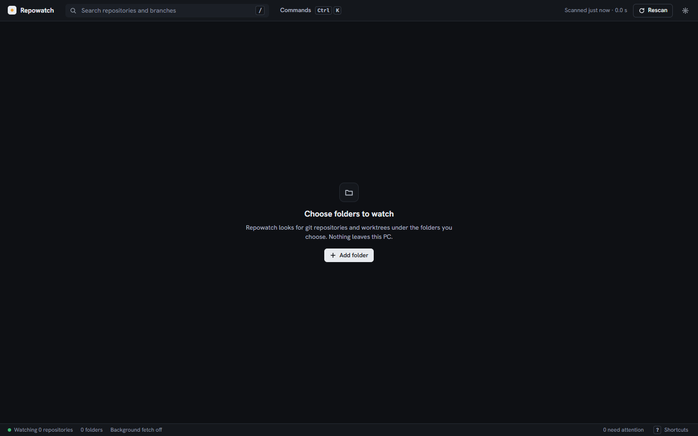

# Repowatch

A light desktop app that shows the git state of every repository on your
machine in one screen, and works as a day-to-day git GUI.

> Version 0.1.0. Built and tested on Windows 11; the code is kept
> cross-platform, but macOS and Linux are not tested yet.

If you keep dozens of repositories and worktrees, you rarely know which ones
have uncommitted work, commits that were never pushed, or branches that were
never merged. Repowatch scans the folders you choose, groups every repository
by what it needs from you, and lets you fix it without leaving the app. It
never force-pushes and never rewrites history.


## Screenshots

| Light                                                                                           | Dark                                                                                          |
| ----------------------------------------------------------------------------------------------- | --------------------------------------------------------------------------------------------- |
|                          |                         |
|    |  |
|                      |        |
|                            |             |

Every screen in both themes at 1440x900 and 1024x700 is in
[docs/screenshots/](docs/screenshots/). The screenshots show the generated
test repositories, not real projects.

## Features

**See everything at once**

- Finds git repositories and linked worktrees under the folders you choose
  (Desktop and Documents by default), skipping `node_modules`, caches, build
  output and any folder you exclude.
- One list grouped by what each repository needs: **At risk** (conflicts,
  detached HEAD, lost commits, unreadable repository), **Uncommitted**
  (staged, modified, untracked), **Out of sync** (commits to push or pull,
  branch without upstream, upstream gone, no remote) and **Loose ends**
  (branches not merged into `main`/`master`, stashes). Colour always comes
  with an icon and words.
- Aligned count columns for staged, modified, untracked, ahead, behind,
  unmerged branches and stashes; current branch, worktrees and last commit.
- Lost commits: commits reachable only from the reflog or left dangling (a
  deleted branch, a reset), within a time window you set (30 days by
  default), checked on demand and recoverable to a new branch.
- Search, filters, sort by attention, name or last commit, and compact or
  comfortable density.
- Updates by itself: file-system events refresh only the repositories that
  changed; a full rescan is one key away.
- Tray icon with a badge counting the repositories that need attention.
  Optional background `git fetch` (off by default, read-only, never pulls or
  pushes).

**Fix it from the same window**

- Changed files with a diff viewer; stage and unstage whole files or single
  hunks; commit.
- Fetch, pull (fast-forward only) and push (current branch only, never
  forced).
- Create and switch branches; delete branches that are already merged.
- List stashes, apply or drop them; recover a lost commit to a new branch.
- Open a repository in VS Code, the terminal or Explorer.
- Push, branch deletion, stash apply and drop, and recovery always ask first
  and name what they act on. Git's own error text is shown when something
  fails.

**Pleasant to use**

- Light and dark themes that follow Windows, or a fixed choice.
- Keyboard first: command palette (`Ctrl K`), `/` to search, `j`/`k` or the
  arrows to move, `Enter` to open, `?` for every shortcut.
- Text contrast of at least 4.5:1 in both themes, visible focus, and reduced
  motion respected.

## Install

Windows 10 or 11, x64. There is no published release yet: build the
installer from source (below) or use one you were given.

1. Run `Repowatch_0.1.0_x64-setup.exe`.
2. The installer is not code-signed, so Windows SmartScreen may say
   "Windows protected your PC". Click **More info**, then **Run anyway**.
3. Accept the MIT licence and click **Install**. It installs for your user
   only, without an administrator prompt.
4. Start Repowatch from the Start menu and add the folders that hold your
   repositories in Settings.

Details, checksums and uninstalling: [docs/BUILD.md](docs/BUILD.md).

## Build from source

Requirements: Rust 1.85 or newer, Node.js 22.12 or newer, git, and on Windows
the WebView2 runtime (built into Windows 11) and the Visual Studio C++ build
tools. The npm scripts that build Rust run through `scripts/msvc-env.mjs`,
which picks a complete Visual Studio installation when the newest one is
partial.

```sh
npm install
npm run tauri dev           # run the app in development
npm run check               # lint, typecheck, all tests and the docs check
npm run build:installer     # build the Windows installer
npm run verify:installer    # check the installer without running it
```

The installer is written to
`target/release/bundle/nsis/Repowatch_0.1.0_x64-setup.exe`. Every script,
the fixture repositories and the safety rules for testing are described in
[CONTRIBUTING.md](CONTRIBUTING.md).

### Project layout

- `crates/core` – the git core library (no Tauri dependency): discovery,
  status, analysis, lost commits and write actions, all through the git CLI.
- `src-tauri` – the Tauri 2 desktop shell: IPC commands, settings, file
  watcher, tray and background fetch.
- `src` – the React + TypeScript frontend (Vite).
- `scripts` – fixtures, checks, end-to-end run, benchmarks and packaging.
- `docs` – decisions, design mocks, build and performance notes.

Design rules are in [DESIGN.md](DESIGN.md); every product, design and
technology decision, including what was left out of v0.1, is in
[docs/DECISIONS.md](docs/DECISIONS.md).

## Performance

Release build of v0.1.0 on Windows 11, Intel Core i5-14400F, NVMe SSD
(2026-10-05). Method and details: [docs/PERFORMANCE.md](docs/PERFORMANCE.md).

| Measurement                                       | Result                                    |
| ------------------------------------------------- | ----------------------------------------- |
| Scan, 50 fixture repositories                     | median 1.11 s, slowest 1.30 s (limit 5 s) |
| Scan, real folders of the author's PC (read-only) | 67 repositories in 1.83 s                 |
| Cold start to first paint                         | median 645 ms                             |
| Cold start to dashboard with 50 repositories      | median 1.20 s                             |
| Idle memory, app + WebView2 (private working set) | 101 MB (app process alone: 5.4 MB)        |
| Installer (NSIS)                                  | 1.5 MB (app executable: 4.0 MB)           |

```sh
npm run bench:check             # scan 50 temporary fixture repositories, fail over 5 s
npm run bench -- --app          # cold start and idle memory of the release app
npm run bench -- --real <dir>   # one read-only scan of your own folders
```

## Privacy

- **No telemetry, no analytics, no accounts.** Repowatch never sends anything
  about you or your repositories anywhere. Nothing leaves your PC.
- **The only network access is git's own**, and only when you ask for it:
  Fetch, Pull and Push in the repository view, and the optional background
  fetch (off by default; when on, it runs `git fetch` on a timer you choose).
  They use your existing git remotes and credentials.
- **Reading is read-only.** The dashboard reads repositories with read-only
  git commands (`--no-optional-locks`, no fetch). Repositories are changed
  only by an action you trigger.
- **Everything is stored locally**: settings are one JSON file in
  `%APPDATA%\io.github.nunomarques97.repowatch`. Fonts are bundled; the
  interface loads nothing from the internet.

## License

[MIT](LICENSE) © 2026 Nuno Marques
