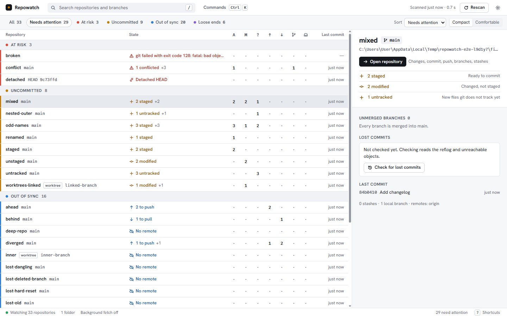

# Repowatch v0.1 — relatório para o Nuno

Data: 5 de outubro de 2026.

## O que é

O Repowatch é uma aplicação para Windows que mostra, num só ecrã, o estado
git de todos os repositórios e worktrees do PC. Responde de relance à
pergunta "que repositórios precisam de mim, e porquê?" e deixa resolver a
maior parte das situações sem abrir a linha de comandos.

## O que faz

- **Encontra os repositórios sozinho.** Procura nas pastas Ambiente de
  Trabalho e Documentos (pode acrescentar ou excluir pastas nas definições),
  ignorando `node_modules`, caches e pastas de compilação.
- **Agrupa por urgência**, com cor, ícone e texto:
  - **At risk** (em risco): conflitos, HEAD destacada, commits perdidos,
    repositório ilegível;
  - **Uncommitted** (por fazer commit): ficheiros staged, modificados ou
    novos;
  - **Out of sync** (dessincronizado): commits por enviar (push) ou por
    receber (pull), ramo sem upstream, repositório sem remoto;
  - **Loose ends** (pontas soltas): ramos não integrados no `main`/`master`,
    stashes.
- **Encontra commits perdidos** (de ramos apagados ou resets) dos últimos 30
  dias e recupera-os para um ramo novo.
- **Funciona como cliente git**: ver as diferenças de cada ficheiro, fazer
  stage e unstage de ficheiros ou de blocos, commit, fetch, pull (só
  fast-forward), push, criar, mudar e apagar ramos já integrados, aplicar e
  descartar stashes, e abrir o repositório no VS Code, no terminal ou no
  Explorador.
- **Segurança**: as ações perigosas pedem sempre confirmação e dizem o que
  vão fazer. Nunca faz force-push nem reescreve o histórico.
- **Ícone na área de notificação** com o número de repositórios que precisam
  de atenção. O fetch automático em segundo plano existe mas vem desligado.
- **Tema claro e escuro** (segue o Windows) e uso completo pelo teclado:
  `Ctrl K` abre a paleta de comandos, `?` mostra todos os atalhos.
- **Privacidade**: não tem telemetria e nada sai do PC. Só usa a rede quando
  o Nuno carrega em Fetch, Pull ou Push, ou se ligar o fetch automático.

A interface está em inglês. Todas as decisões que tomei sozinho estão em
[DECISIONS.md](DECISIONS.md) (17 decisões, incluindo o que ficou de fora da
v0.1, na decisão 16).

### Números medidos neste PC

| Medida                                         | Resultado                    |
| ---------------------------------------------- | ---------------------------- |
| Análise dos seus repositórios (só leitura)     | 67 repositórios em 1,83 s    |
| Arranque até mostrar 50 repositórios           | 1,20 s                       |
| Memória em repouso (aplicação + WebView2)      | 101 MB                       |
| Tamanho do instalador                          | 1,5 MB                       |

Durante o desenvolvimento os seus repositórios só foram lidos uma vez, para
esta medição. Todos os testes que escrevem foram feitos em repositórios de
teste criados numa pasta temporária.

## Como instalar

1. No Explorador de Ficheiros, abra a pasta do projeto e, dentro dela,
   `target\release\bundle\nsis` (ou a pasta para onde o instalador foi
   copiado).
2. Faça duplo clique em `Repowatch_0.1.0_x64-setup.exe`.
3. O Windows vai mostrar "O Windows protegeu o seu PC", porque o instalador
   não está assinado. Clique em **Mais informações** e depois em **Executar
   mesmo assim**.
4. Clique em **Next**, aceite a licença MIT e continue até clicar em
   **Install**. Não pede palavra-passe de administrador; instala só para o
   seu utilizador.
5. Clique em **Finish** e abra o Repowatch pelo menu Iniciar (escreva
   "Repowatch").
6. Os repositórios do Ambiente de Trabalho e dos Documentos aparecem
   sozinhos. Para acrescentar outra pasta: clique no botão das definições,
   em cima à direita de **Rescan** (ou carregue em `Ctrl` + `,`), depois em
   **Add folder**, e escolha a pasta.

Para desinstalar: Definições do Windows > Aplicações > Aplicações
instaladas > Repowatch > **...** > **Desinstalar**.

## O que decidir antes de tornar o repositório público no GitHub

O repositório remoto já configurado é `github.com/nunomarques97/repowatch`.
Nada foi enviado nem publicado. Para cada ponto deixo a minha recomendação.

1. **O seu email nos commits.** O commit inicial tem o seu email pessoal, e
   num repositório público qualquer pessoa o vê. Recomendo usar o email
   anónimo que o GitHub dá (`...@users.noreply.github.com`) nos próximos
   commits. O commit que já existe continua a mostrar o email, a não ser que
   o histórico seja refeito antes de publicar.
2. **Ficheiros internos do assistente.** `CLAUDE.md` e `AGENTS.md` têm
   instruções para os agentes de IA (FORJA) e não interessam a quem usa o
   Repowatch. Recomendo tirá-los do repositório público (a pasta `.forja/`
   já é ignorada pelo git).
3. **Assinatura do instalador.** Sem assinatura, o Windows mostra o aviso do
   passo 3 a todas as pessoas que o descarregarem. Opções: (a) publicar sem
   assinatura e indicar o código SHA-256 do ficheiro (custo zero; é o que
   recomendo para a v0.1); (b) candidatar o projeto a um programa gratuito de
   assinatura para projetos open source, que tem de aprovar o projeto; (c)
   comprar um certificado de assinatura (pago, todos os anos).
4. **Como distribuir o instalador.** Recomendo uma "Release" no GitHub com o
   instalador e o seu código SHA-256. Também pode decidir se quer
   verificações automáticas no GitHub (GitHub Actions, gratuito em
   repositórios públicos); ainda não estão configuradas.
5. **O que ficou de fora da v0.1** (decisão 16 em
   [DECISIONS.md](DECISIONS.md)): por exemplo stage de linhas soltas, pull
   que não seja fast-forward, criar stashes, histórico de commits, macOS e
   Linux. Decida se publica assim ou se alguma destas falta primeiro.
6. **Nome e licença.** O nome Repowatch está livre no crates.io e não há
   nenhuma aplicação conhecida com este nome (decisão 1). A licença é MIT, em
   nome de Nuno Marques, 2026. Confirme as duas coisas.
7. **Imagens no README.** Mostram só os repositórios de teste e uma pasta
   temporária com o nome de utilizador do Windows ("User"). Nenhum projeto
   seu aparece. Não precisa de fazer nada, a menos que prefira outras
   imagens.

Quando tiver decidido, basta dizer-me as escolhas; tornar o repositório
público é sempre um passo seu.
